<h1 align="center">graph-wiki</h1>

<p align="center"><b>A digital brain you grow with your AI agent.</b></p>

<p align="center">
  It remembers what you figure out, connects it to what you already know,<br>
  and answers when you ask.
</p>

<p align="center">
  <a href="https://pypi.org/project/graph-wiki-skills/"></a>
  <a href="https://deepwiki.com/wenxueliu/graph-wiki"></a>
  <a href="https://github.com/wenxueliu/graph-wiki/pulls"></a>
</p>

<p align="center">
  
</p>

<p align="center">
  English | <a href="https://github.com/wenxueliu/graph-wiki/blob/main/README_ZH.md">简体中文</a>
</p>

---

You solve a hard problem on a Tuesday. Three months later, in a different repo, you solve it again from scratch — because the answer lived in a chat log you'll never find.

This fixes that. Point it at a folder, tell your agent what to remember, and it compiles what you learn into interconnected markdown you own. The pattern comes from Andrej Karpathy's [LLM Wiki gist](https://gist.github.com/karpathy/442a6bf555914893e9891c11519de94f): compile knowledge once and keep it current, instead of asking an LLM the same questions forever or re-running RAG every time.

**Your second brain. Your AI agent is how you grow it.**

Every skill here is a markdown file that any agent — Claude Code, Cursor, Codex, Windsurf, Gemini CLI, and [many more](https://github.com/wenxueliu/graph-wiki/blob/main/docs/agents.md) — reads and runs. Deterministic local helpers handle hashing and bounded text ranges; there is no hosted runtime, API key, or vendor lock-in.

## 60 seconds

```bash
pip install graph-wiki-skills
cd /path/to/your/project
graph-wiki setup
```

Setup installs skills only in the current project. Open that project in your agent and say **"set up my wiki"**.

Prefer not to touch a terminal? Give your agent this and it'll do the whole thing:

```text
https://github.com/wenxueliu/graph-wiki — set up my wiki
```

Other paths — `git clone`, Skills CLI, multiple vaults → **[Installation](https://github.com/wenxueliu/graph-wiki/blob/main/docs/installation.md)**

## What you actually do

**Feed it.** Local Markdown, plain-text, and reStructuredText documents are ingested through a
resumable, context-bounded pipeline. Agent histories and web research use their dedicated skills.

```text
/wiki-folder-ingest ~/research
/wiki-update                        # distill the repo you're standing in
/wiki-capture                       # save this conversation
/wiki-history-ingest claude         # mine everything you've ever asked Claude
```

**Ask it.** Answers come back with `[[wikilink]]` citations, not vibes.

```text
/wiki-query what do I know about rate limiting?
/wiki-narrate MCP security          # a cited briefing on a topic
/wiki-digest week                   # what did I learn this week?
```

**Find that session you can't name.**

```bash
graph-wiki sessions-build
graph-wiki sessions-query "the auth bug with the weird retry loop"
```

**Keep it honest.** The vault gets messy on its own; these clean it.

```text
/wiki-lint            # broken links, orphans, contradictions
/wiki-dedup           # "RSC" and "React Server Components" are one page now
/cross-linker         # weave new pages into the graph
/wiki-status          # what's ingested, what's pending, where the hubs are
```

All 50 skills → **[Skills Reference](https://github.com/wenxueliu/graph-wiki/blob/main/docs/skills.md)**

## How the skills fit together

Each skill is a standalone markdown file, but they share one vault and a small set of contracts.
The diagram reads left to right: a **source** enters, a skill **processes and writes** it, the
**vault** stores the compiled pages, and **query or maintenance** skills read or maintain it. Solid
arrows are data flow or explicit workflow calls; dashed arrows are staging hand-offs. Colors follow
the six stages, and dashed nodes are internal, worker-only, sidecar, or staging artifacts. Every
vault skill resolves `wiki-context` first, writers freeze `wiki-page-contract`, and the worker skills
(`wiki-*-contract`, `wiki-source-text`, `wiki-ingest-document`, `wiki-packet-integrate`,
`wiki-finalize-sources`) run only under the coordinator that owns them.

```mermaid
%%{init: {"flowchart": {"curve": "basis", "nodeSpacing": 20, "rankSpacing": 38, "padding": 8}}}%%
flowchart LR
  subgraph SRC["① Inputs"]
    direction TB
    conv(["Conversation"])
    proj(["Code project<br/>README · docs · git"])
    docs(["Local text<br/>.md · .txt · .rst"])
    hist(["Agent sessions<br/>claude · codex · copilot ..."])
    web(["Research topic"])
    wxurl(["WeChat article URL"])
  end

  subgraph ING["② Process & write"]
    direction TB
    setup("wiki-setup")
    setupc("wiki-setup-contract")
    ctx[("wiki-context")]
    pc[("wiki-page-contract")]
    cap("wiki-capture")
    upd("wiki-update")
    ing("wiki-ingest<br/>lightweight")
    doc("wiki-ingest-document<br/>worker")
    folder("wiki-folder-ingest<br/>recoverable")
    src("wiki-source-text<br/>worker")
    pkt("wiki-packet-integrate<br/>worker")
    fin("wiki-finalize-sources<br/>worker")
    sc("wiki-stage-commit")
    histskill("wiki-history-ingest")
    adapters("claude · codex · copilot<br/>hermes · openclaw · pi")
    agent("wiki-agent")
    res("wiki-research")
    wx("wechat-article-fetcher")
    raw[("_raw/ staging")]
    sb("session-brain<br/>sidecar · never writes vault")
    ss("session-search")

    setup --> setupc
    setup --> ctx
    ctx --> pc
    cap -. "quick" .-> raw
    wx -. "archive" .-> raw
    raw --> folder
    ing --> doc
    folder --> src --> pkt
    folder --> fin
    sc --> fin
    sb --> ss
    agent -. "topic slice" .-> adapters
  end

  vault[("③ Obsidian vault<br/>compiled markdown")]

  subgraph READ["④ Query & output"]
    direction TB
    q("wiki-query")
    nar("wiki-narrate")
    dig("wiki-digest")
    pack("wiki-context-pack")
    bridge("memory-bridge")
  end

  subgraph MAIN["⑤ Maintain"]
    direction TB
    st("wiki-status")
    lint("wiki-lint") --> lc("wiki-lint-consolidate")
    dd("wiki-dedup")
    xl("cross-linker")
    ovl("obsidian-vault-linker")
    tags("tag-taxonomy")
    syn("wiki-synthesize")
    rb("wiki-rebuild")
    daily("daily-update") --> ds("daily-update-setup")
    daily --> iv("impl-validator")
    dd -. "fill gaps" .-> xl
  end

  subgraph PRES["⑥ Present & extend"]
    direction TB
    gc("graph-colorize")
    dash("wiki-dashboard")
    exp("wiki-export") <--> imp("wiki-import")
    lay("obsidian-layout-adjustment")
    skill("skill-creator")
    vsf("vault-skill-factory")
    llm("llm-wiki<br/>pattern reference")
  end

  conv --> cap
  proj --> upd
  docs --> ing
  docs --> folder
  hist --> histskill
  hist --> agent
  hist --> sb
  web --> res
  wxurl --> wx
  histskill --> adapters

  setup --> vault
  cap --> vault
  upd --> vault
  doc --> vault
  pkt --> vault
  fin --> vault
  sc --> vault
  adapters --> vault
  agent --> vault
  res --> vault

  vault --> READ
  vault <--> MAIN
  vault <--> PRES

  classDef input fill:#EFF6FF,stroke:#3B82F6,stroke-width:1.6px,color:#1E3A8A
  classDef skill fill:#F5F3FF,stroke:#7C3AED,stroke-width:1.5px,color:#1F2937
  classDef internal fill:#FFFFFF,stroke:#C4B5FD,stroke-width:1.1px,stroke-dasharray:4 3,color:#6B7280
  classDef worker fill:#FFFFFF,stroke:#D8B4FE,stroke-width:1.1px,stroke-dasharray:4 3,color:#6B7280
  classDef staging fill:#F8FAFC,stroke:#64748B,stroke-width:1.2px,stroke-dasharray:5 3,color:#334155
  classDef vault fill:#FFFBEB,stroke:#D97706,stroke-width:2.8px,color:#78350F,font-size:16px,font-weight:bold
  classDef query fill:#ECFDF5,stroke:#059669,stroke-width:1.5px,color:#064E3B
  classDef maintain fill:#FFF1F2,stroke:#E11D48,stroke-width:1.5px,color:#881337
  classDef present fill:#F0F9FF,stroke:#0284C7,stroke-width:1.5px,color:#0C4A6E
  classDef sidecar fill:#F8FAFC,stroke:#64748B,stroke-width:1.1px,stroke-dasharray:5 3,color:#334155
  classDef adapter fill:#FFFFFF,stroke:#A78BFA,stroke-width:1.1px,color:#4C1D95
  classDef reference fill:#FFFFFF,stroke:#94A3B8,stroke-width:1px,stroke-dasharray:4 2,color:#64748B

  class conv,proj,docs,hist,web,wxurl input
  class setup,cap,upd,ing,folder,sc,histskill,agent,res,wx skill
  class setupc,ctx,pc internal
  class doc,src,pkt,fin worker
  class raw staging
  class vault vault
  class q,nar,dig,pack,bridge query
  class st,lint,lc,dd,xl,ovl,tags,syn,rb,daily,ds,iv maintain
  class gc,dash,exp,imp,lay,skill,vsf present
  class sb,ss sidecar
  class adapters adapter
  class llm reference

  style SRC fill:#F7FAFF,stroke:#BFDBFE,stroke-width:1.5px,color:#1E40AF
  style ING fill:#FCFAFF,stroke:#DDD6FE,stroke-width:1.5px,color:#5B21B6
  style READ fill:#F7FDFA,stroke:#A7F3D0,stroke-width:1.5px,color:#065F46
  style MAIN fill:#FFF8F8,stroke:#FECDD3,stroke-width:1.5px,color:#9F1239
  style PRES fill:#F7FCFF,stroke:#BAE6FD,stroke-width:1.5px,color:#075985

  linkStyle default stroke:#94A3B8,stroke-width:1.25px
```



## See it

Open the vault in Obsidian and hit the graph view (Cmd/Ctrl+P → "Open graph view"). Say **"color my graph"** and it tints nodes by tag, category, or visibility.

<p align="center">
  
</p>

Or export the whole graph to `graph.json`, GraphML (Gephi/yEd), Neo4j Cypher, or a self-contained interactive `graph.html`.

## Why this and not a notes folder

- **It compiles, it doesn't accumulate.** New knowledge merges into existing pages. Contradictions get flagged. Nothing gets duplicated.
- **It only reads what changed.** A manifest tracks every source ingested, so the second run processes the delta — not your whole library again.
- **You can tell knowledge from guessing.** Every claim is tagged `extracted`, `^[inferred]`, or `^[ambiguous]`, and lint flags pages drifting into speculation.
- **Queries stay cheap as it grows.** Titles, tags, and summaries get read before page bodies. 20 pages or 2000, roughly the same cost.
- **It's yours.** Plain markdown in a folder. Push it to a private repo, open it in Obsidian, grep it, delete it. No service, no lock-in, nothing leaves your machine.
- **Works where you already work.** One bundled `.skills/` directory, linked into each selected agent under your project.

More → **[Architecture](https://github.com/wenxueliu/graph-wiki/blob/main/docs/architecture.md)**

## Documentation

These docs are available in English and Simplified Chinese.

| | |
|---|---|
| **[Installation](https://github.com/wenxueliu/graph-wiki/blob/main/docs/installation.md)** | pip, clone, agent-driven setup, multiple vaults |
| **[Skills Reference](https://github.com/wenxueliu/graph-wiki/blob/main/docs/skills.md)** | All 50 skills and their slash commands |
| **[Agent Compatibility](https://github.com/wenxueliu/graph-wiki/blob/main/docs/agents.md)** | The full matrix + per-agent manual setup |
| **[CLI Reference](https://github.com/wenxueliu/graph-wiki/blob/main/docs/cli.md)** | Every `graph-wiki` subcommand |
| **[Configuration](https://github.com/wenxueliu/graph-wiki/blob/main/docs/configuration.md)** | Config vars, QMD semantic search, `_raw/` staging, GitHub sync |
| **[Architecture](https://github.com/wenxueliu/graph-wiki/blob/main/docs/architecture.md)** | The four ingest stages, vault structure, what we added to Karpathy's pattern |
| **[Session Brain](https://github.com/wenxueliu/graph-wiki/blob/main/docs/session-brain.md)** | Topic graph over your agent session history |
| **[Contributing](https://github.com/wenxueliu/graph-wiki/blob/main/docs/contributing.md)** | Adding skills, keeping the English and Chinese docs in sync |

## Contributing

This is early. The skills work, but there's room to make the brain smarter — better cross-referencing, sharper deduplication, bigger vaults, new ingest sources. If you have a workflow that could be a skill, [PRs are welcome](https://github.com/wenxueliu/graph-wiki/blob/main/docs/contributing.md).

## License

[Apache License 2.0](https://github.com/wenxueliu/graph-wiki/blob/main/LICENSE)

See [NOTICE](https://github.com/wenxueliu/graph-wiki/blob/main/NOTICE) for upstream attribution.

## Acknowledgements

graph-wiki builds on the design and implementation of [obsidian-wiki](https://github.com/Ar9av/obsidian-wiki). Thank you to Ar9av for the original work.
